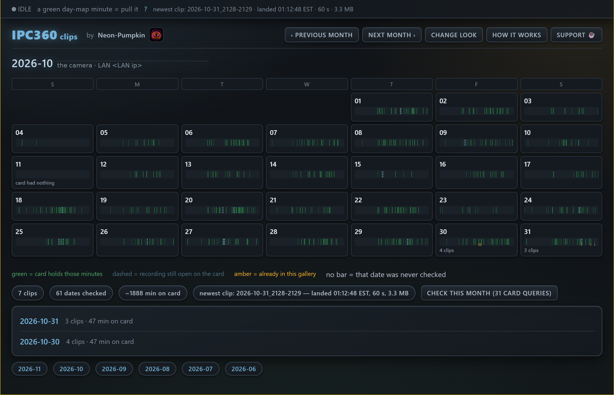
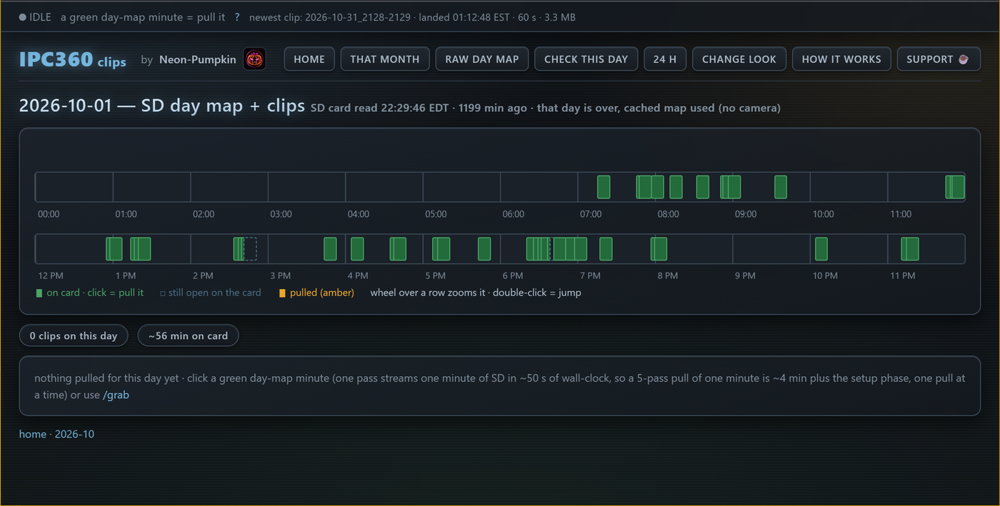
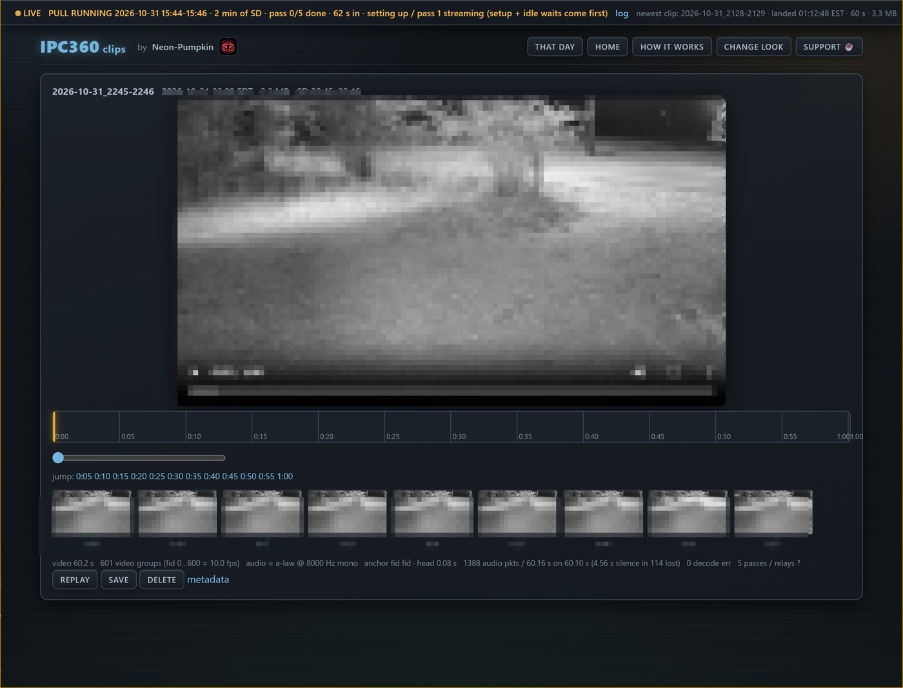

# ipc360 — Browse and download IPC360 / Puwell camera recordings

`ipc360` lets you check what is stored on a compatible camera's SD card, download selected recordings, and watch or save them as ordinary video files. It works without using the IPC360 phone app to browse or play those recordings.

The project contains two Python programs:

| File | Purpose |
|---|---|
| `ipc360.py` | Command-line tool. It checks the camera's recording timeline and downloads a selected time range. It can also assemble the downloaded data into video and audio files. |
| `camclips.py` | A small web gallery for the recordings you have downloaded. Open it in a browser on your computer, phone, or tablet. |
| `PROTOCOL.md` | Technical notes explaining the reverse-engineered IPC360 / Puwell communication protocol. This is mainly for developers. |

## What the tool does

The camera records video to its SD card. The IPC360 app does not provide a convenient way to browse every day on the card or export a selected recording as a normal video file. This project provides another way to do that:

1. **Check the recording timeline.** The tool asks the IPC360 service which minutes of a selected day contain recordings.
2. **Choose a time range.** You can select a recorded minute from the web gallery or specify a start and end time on the command line.
3. **Download the recording.** The cloud service coordinates a separate peer-to-peer (P2P) connection to the camera. Video data arrives through that P2P connection, either through a relay or through the available local-network path.
4. **Watch or save the result.** The tool can assemble the downloaded video and audio into files that can be played outside the IPC360 app.

The tool does not change the camera's settings or write to its SD card. It reads the recording index and retrieves existing recordings. An internet connection is still required for account login and the camera-service requests. This is not an offline camera-access method.

## What it looks like

These are the gallery's three main pages. The camera's network address and the video frame are changed in the pictures; in a real run they show your own address and your own yard.

**The month calendar** — one cell per date. The thin bar inside a cell is that date's 24-hour timeline: green is video the camera's SD card holds, amber is video the gallery already has.



**One day** — the day map as two 12-hour rows. Click a green minute to download it, scroll the mouse wheel over a row to zoom that row, and a date that is already over opens from its saved day map without asking the camera.



**One clip** — the video starts playing on its own, the ruler below it seeks by minute, the slider and the row of still images jump to a second, and the line under the buttons says honestly what was downloaded (length, frame rate, audio, decode errors).



The frame is blurred in the clip picture; a real one shows your own yard. Use `/look` to change how the gallery looks — the effects change only the pages, never the camera or the downloaded video.

## Camera compatibility

This project uses the IPC360 / Puwell **PW native network SDK** protocol. It has been tested with one Puwell-SDK camera enrolled in the `com.ipc360` app. Compatibility with other cameras has not been confirmed.

- **Expected to work:** another camera using the same PW SDK and IPC360 app/account system.
- **May work:** another model from the same brand, provided it uses a compatible version of the PW SDK.
- **Will not work:** an unrelated ONVIF or RTSP camera, or a camera that uses a different app and protocol. This project does not implement a general ONVIF or RTSP client.

Each camera has its own `camId`. The camera must already be enrolled in the account you use to log in. The tool does not discover or add cameras to your account.

The quickest compatibility check is to run `--list` for a date on which the camera is known to have recordings. If the manager returns a day map containing recorded minutes, the camera is responding to the protocol.

## Requirements

You need:

- **Python 3**.
- **FFmpeg and FFprobe** for creating the finished video, checking media information, and generating the gallery's still images.
- An internet connection for logging in and requesting the camera's recording index and video.

The day-map request and raw recording download do not require FFmpeg. If FFmpeg is unavailable, `--no-ffmpeg` can save the raw video and audio data instead of creating the finished media files.

Install FFmpeg using the package manager for your operating system:

| Operating system | Install FFmpeg |
|---|---|
| Windows | Download a Windows build from [ffmpeg.org](https://ffmpeg.org/download.html), extract it, and either add its `bin` folder to `PATH` or use its full path. |
| macOS | `brew install ffmpeg` |
| Debian / Ubuntu / Raspberry Pi OS | `sudo apt install ffmpeg` |
| Arch Linux | `sudo pacman -S ffmpeg` |
| Fedora | `sudo dnf install ffmpeg` |

Check that Python and both FFmpeg programs are available:

```sh
python3 --version
ffmpeg -version
ffprobe -version
```

On Windows, you can start the scripts with `py` or `python` if that is how Python is installed. The gallery starts its download and map-check jobs with the same interpreter that started it (`sys.executable`), so it works whichever command you used to launch Python.

## Installation

Clone the repository:

```sh
git clone https://github.com/Neon-Pumpkin/ipc360.git
cd ipc360
```

There is no build step and no Python package installation. The scripts use Python's standard library; FFmpeg is the only external media tool they need.

You can also download the repository as a ZIP file and extract it.

## First-time setup

Run:

```sh
python3 ipc360.py --setup
```

The setup process asks for the information the tool needs:

- The email address used to sign in to the IPC360 app.
- The password for that account.
- The camera's `camId` (a numeric camera identifier).
- The camera's local-network IP address (optional; intended for the direct-LAN fallback).
- The folder where downloaded clips and gallery data should be stored. The default is `camclips-share`.

The program saves these values in `ipc360-config.json` beside the script. Every saved value is read back as a default when you run the tool later: the environment wins, then the settings file, then the built-in default. That means you do not have to repeat `--cam-ip`, `--cam-port`, or `--login-mgr` on every command after a successful setup.

### Important: protect the settings file

The settings file contains your IPC360 email address and password in **plain text**. The repository's `.gitignore` excludes `ipc360-config.json`, so a normal setup inside this checkout is never offered to `git add`. On systems with Unix-style file permissions, the program also sets the file to mode `0600`.

None of this is encryption. It does not protect the password from someone who can read the file, from a backup or sync service that copies it, or on Windows and network shares where Unix permission bits do not apply. If you keep settings under a different name with `IPC360_CONFIG`, add that name to `.gitignore` yourself, and keep the file readable only by the account that needs it. Never paste the file into an issue report.

### Finding the camera ID (`camId`)

The `camId` is a 32-bit number assigned to the camera within the IPC360 system. It is not the camera's local IP address, and it does not change when the camera moves to another network.

Check the camera's device information in the IPC360 app first. If you have possible IDs but do not know which one belongs to the camera, the tool can test them:

```sh
python3 ipc360.py --find-cam 1003637840 1234567890
```

Each candidate is tested with a day-map request. The tool does not download video while checking IDs.

You can also extract candidate IDs from a saved login capture:

```sh
python3 ipc360.py --find-cam --scan app-log.txt
```

The advanced method is to capture the app's login traffic with a tool such as `tcpdump` and inspect the login packet. This is intended for users who are comfortable inspecting network captures.

## Quick start

After setup, check a date on which you know the camera recorded video:

```sh
python3 ipc360.py --list --day 2026-10-30
```

The output shows which minutes contain recordings. The date uses the camera's recording day; the program reports the time-zone offset returned by the service.

Start the web gallery:

```sh
python3 camclips.py --serve
```

On the same computer, open:

```text
http://localhost:8795/
```

To open the gallery from another device on your local network, use the computer's LAN IP address instead of `localhost`, for example `http://192.168.1.20:8795/`.

The server runs in the foreground. Press `Ctrl+C` in the terminal to stop it. To keep it running in the background on Linux, use a process manager such as systemd; an example is provided below.

## Downloading recordings from the command line

### Check what is recorded

```sh
python3 ipc360.py --list --day 2026-10-30
```

This requests the day's recording timeline from the IPC360 service. It does not download video.

### Download and assemble a time range

```sh
python3 ipc360.py --play 13:00-13:01 --day 2026-10-30 \
    --out probes/segment --seconds 120 --idle 15 --passes 5
```

This downloads the selected range and assembles the received data into media files. The output includes:

- `segment.mp4` — the video and audio in a playable MP4 file.
- `segment.mkv` — the assembled video/audio in Matroska format.
- `segment.wav` — the extracted audio.
- `segment.stats.json` — information about the downloaded data and its completeness.
- Raw `.wire` files — the received network data, retained so the download can be assembled again or combined with another pass.

The `--out` argument names the output prefix. The tool creates the files in the directory containing that prefix.

### Difference between `--pull` and `--play`

- `--pull` downloads and saves the raw `.wire` data. It does not assemble a finished video.
- `--play` performs the download and then assembles the collected data into media files.
- `--from-wire` assembles previously saved `.wire` files. This operation works offline; it does not contact the camera or the IPC360 service.

For example, to assemble saved data from two downloads of the same time range:

```sh
python3 ipc360.py --from-wire \
    first-pull.wire,second-pull.wire \
    --out probes/merged/segment
```

Replace `first-pull.wire` and `second-pull.wire` with the actual file paths. List the files as comma-separated paths; the command expects explicit filenames rather than wildcard patterns. The files must come from the **same camera and the same requested time range**. The tool combines the received chunks and attempts to fill gaps left by packet loss on an individual pass.

If you only want the raw streams and do not want FFmpeg to create the MP4/MKV/WAV files, add `--no-ffmpeg`.

### Why there is a `--passes` option

The camera or relay may fail to deliver some data during a download. Repeating the same time range can recover chunks that were missing on an earlier pass. The tool combines the chunks collected across passes.

More passes usually improve completeness, but they also increase download time. The following results came from one test of a one-minute recording; they are an example, not a guarantee for every camera or recording:

| Passes | Incomplete groups | Video frames | Decode errors |
|---:|---:|---:|---:|
| 1 | 11 | 1005 | 8 |
| 3 | 5 | 1178 | 1 |
| 5 | 2 | 1199 | 1 |
| 7 | 0 | 1199 | 0 |

A larger pass count does not guarantee a perfect recording. Some data may never be delivered by the camera. Check the decode-error count and watch the resulting clip to judge its quality. The time required depends on the clip length, number of passes, camera response, and network path.

## Using the web gallery

Start it with:

```sh
python3 camclips.py --serve
```

The default port is `8795`. You can choose another port with `--port`:

```sh
python3 camclips.py --serve --port 9000
```

The gallery provides these pages and functions:

| Page | What it does |
|---|---|
| `/` | Shows a monthly calendar. Each day has a timeline showing which minutes are recorded and which clips have already been downloaded. The calendar uses cached day maps; it does not contact the camera just to draw the month. |
| `/day?day=YYYY-MM-DD` | Shows that day's recording timeline. Green sections represent recorded minutes that can be downloaded. Amber sections represent clips already in the gallery. You can zoom the timeline with the mouse wheel and click a recorded minute to download it. |
| `/clip?name=CLIPNAME` | Opens a clip. The video starts automatically when the browser allows it. Use the timeline, slider, or still images to seek to a particular moment. |
| `/pull?day=YYYY-MM-DD&range=HH:MM-HH:MM` | Starts a download and keeps the browser on the day's page. The status bar shows progress and opens the clip page when the file is ready. |
| `/look` | Lets you turn visual effects on or off. These effects change only the gallery's appearance; they do not affect the camera or the downloaded video. |
| `/delete?name=CLIPNAME` | Shows which gallery files will be deleted and asks for confirmation. The recording remains on the camera's SD card and can be downloaded again. |
| `/sweep?m=YYYY-MM` | Requests and caches a day map for every date in the selected month. This makes the calendar's timelines available without opening each date individually. |
| `/status` | Shows the current download/check status and recent log output. |

A day that already has a complete cached day map can be opened without another camera request. Use the page's refresh option, or `/refresh?day=YYYY-MM-DD`, to request an updated map when needed.

The gallery also supports direct file downloads at `/dl/CLIPNAME.mp4` and machine-readable status/day-map endpoints such as `/status.json` and `/api/daymap?day=YYYY-MM-DD`.

**Run `camclips.py` from the repository directory.** The gallery starts `ipc360.py` using a path relative to its current working directory. When running it as a service, set `WorkingDirectory` to the directory containing both scripts.

### What the gallery's colours mean

- **Green:** the camera's SD card reports recorded video for that minute. Click it to download the minute.
- **Dashed blue:** the minute is still being written to the SD card. Wait until recording has finished before trying to download it.
- **Amber:** a copy of that minute is already available in the gallery. Click it to open the downloaded clip.

### Deleting a clip

Deleting a clip from the gallery removes the gallery's copy: the MP4, poster image, thumbnails, metadata file, and the gallery's working folder for that clip. It does **not** delete the recording from the camera's SD card. A clip imported from a command-line run keeps its original files in the CLI output directory.

## Network access and security

The gallery uses Python's built-in HTTP server. It listens on `0.0.0.0`, which means it accepts connections on the computer's network interfaces. It uses **plain HTTP**, has **no login**, and does not provide HTTPS.

Anyone who can reach the gallery can view and download its clips, start downloads from the camera, and delete clips from the gallery. Do not expose this server directly to the public internet. Run it only on a network you trust, and use your firewall or a private network/SSH tunnel to limit access.

For example, an SSH tunnel can make the gallery available on your own computer without opening the gallery port to the wider network:

```sh
ssh -L 8795:localhost:8795 user@camera-server
```

Then open `http://localhost:8795/` on the computer running the SSH command.

## Where files are stored

The `share` folder selected during setup is where the gallery keeps its data. By default, it is `camclips-share`.

It can contain:

- Downloaded MP4 clips.
- A poster image and still thumbnails for each clip.
- A JSON sidecar file containing information about each clip.
- Cached day maps (`daymap-YYYY-MM-DD.json`).
- Gallery preferences (`prefs.json`).
- Download logs and lock/status files used to prevent overlapping downloads.

You can change the share folder for one run with `CAMCLIPS_SHARE`:

```sh
CAMCLIPS_SHARE=/srv/camera/clips python3 camclips.py --serve
```

You can select a different settings file with `IPC360_CONFIG`:

```sh
IPC360_CONFIG=/path/to/other-camera.json python3 ipc360.py --list --day 2026-10-30
```

This is useful when one computer manages more than one camera. Each camera needs its own settings file and its own camera ID. Keep each configuration file outside source control.

## Configuration variables

| Variable | Default | Purpose |
|---|---|---|
| `IPC360_CONFIG` | `ipc360-config.json` | Path to the settings file. |
| `IPC360_EMAIL` | From settings file or prompt | IPC360 account email. |
| `IPC360_PW` | From settings file or prompt | IPC360 account password. |
| `IPC360_CREDS_FILE` | Not set | Path to a text file containing the account email and password on separate lines. |
| `IPC360_CAM_ID` | From settings file | Camera's numeric `camId`. |
| `IPC360_LOGIN_MGR` | `52.8.101.180:19000` | Account/login manager. This may need to be changed for a different service region. |
| `IPC360_CAM_IP` | From settings file, otherwise not set | LAN IP of the camera. Used only by the direct-LAN fallback, when the cloud manager gives no relay endpoint. |
| `IPC360_CAM_PORT` | From settings file, otherwise `23456` | Camera P2P port on that LAN IP. |
| `CAMCLIPS_SHARE` | From settings file, otherwise `camclips-share` | Folder used by the gallery for clips, cached maps, preferences, and its lock file. |
| `IPC360_DIR` | The current directory | Where `ipc360.py` lives, when the gallery should run it from somewhere else. |
| `IPC360_LOCK` | `camclips-share/grab.lock` | Lock-file path used by the command-line tool to avoid overlapping downloads. |
| `IPC360_RUNNING` | `camclips-share/grab-running.json` | Status-file path associated with the command-line lock. |

For the camera ID, an explicit `--cam` option takes precedence over `IPC360_CAM_ID`, which takes precedence over the settings file. The same order applies to `--cam-ip`, `--cam-port` and `--login-mgr`: option, then environment variable, then the settings file, then the built-in default. For account credentials, `IPC360_EMAIL` and `IPC360_PW` take precedence over values in the settings file; `IPC360_CREDS_FILE` is used if a value is not present there, and the program prompts for anything still missing.

If you change `CAMCLIPS_SHARE`, also point `IPC360_LOCK` and `IPC360_RUNNING` to the matching files inside that share folder. Otherwise, the gallery and command-line tool may look for their lock/status files in different locations.

The login manager can also be selected directly:

```sh
python3 ipc360.py --login-mgr 52.8.101.180:19000 --list --day 2026-10-30 --cam 1234567890
```

## Running the gallery with systemd

On Linux, you can use systemd to start the gallery automatically. For example, save the following as `/etc/systemd/system/camclips.service` and adjust the paths to match your installation:

```ini
[Unit]
Description=IPC360 camera clips gallery
After=network.target

[Service]
WorkingDirectory=/srv/camera
ExecStart=/usr/bin/python3 /srv/camera/camclips.py --serve --port 8795
Environment=IPC360_DIR=/srv/camera
Environment=CAMCLIPS_SHARE=/srv/camera/camclips-share
Environment=IPC360_LOCK=/srv/camera/camclips-share/grab.lock
Environment=IPC360_RUNNING=/srv/camera/camclips-share/grab-running.json
Restart=on-failure

[Install]
WantedBy=multi-user.target
```

Make sure the service can read the settings file and write to the share folder. Keep the settings file and any other file containing credentials readable only by the account that needs them.

**Do not restart or stop the service while a download is running.** Stopping the service also stops its download process and can leave a lock file behind. The gallery treats a lock as active for up to 20 minutes.

## Technical details

`PROTOCOL.md` describes how the communication works at the packet level. It covers the message format, manager commands, the P2P connection, day-map data, video/audio chunk assembly, and the issues discovered while reverse-engineering the protocol.

You do not need to read `PROTOCOL.md` to install or use the tools. It is intended for developers who want to understand or modify the protocol implementation.

## Known limitations

- Testing so far has covered one camera and one month's recordings. Other camera models may work, but they have not been verified.
- The protocol was reverse-engineered from the IPC360 app's SDK. An app, firmware, or service update could change the protocol and break compatibility.
- Some video/audio chunks may not be delivered. Repeating a download can recover some missing data, but it cannot recover data the camera never sends.
- This is an unofficial project. It is not affiliated with, endorsed by, or approved by IPC360, Puwell, or any camera manufacturer. Use it only with a camera and account you are authorized to access.

## Reporting a problem

When opening an issue, include:

1. The exact command you ran.
2. The complete terminal output, with passwords, account details, public IP addresses, and other private information removed.
3. The clip's `.stats.json` sidecar file (for example, `segment.stats.json`), or the completeness/error information shown by the gallery.
4. Whether the day map showed the expected recorded minutes.

A description of the problem is helpful too. For example, say which date and time range is affected and whether the video, audio, or both are incorrect. Do not post your password, configuration file, or an unredacted network capture.

## Author

[Neon-Pumpkin](https://github.com/Neon-Pumpkin) · [Buy Me a Coffee](https://buymeacoffee.com/neonpumpkin)

## License

MIT. See [LICENSE](LICENSE).
